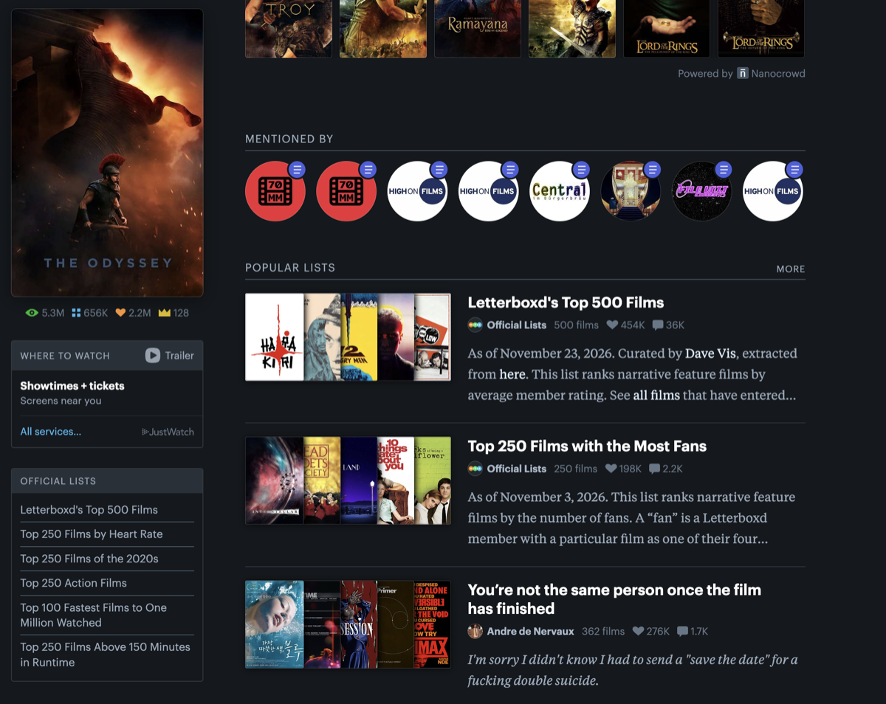

# Official Lists for Letterboxd

A Chrome extension that shows which [Letterboxd official lists](https://letterboxd.com/official/) include a film. The lists appear on the film page, below **Where to watch**.



Not affiliated with Letterboxd.

## Install

1. Clone or download this repository.
2. Open `chrome://extensions` and turn on **Developer mode**.
3. Click **Load unpacked** and select the `extension/` folder.
4. Open a film page, for example [Branded to Kill](https://letterboxd.com/film/branded-to-kill/).

After you change the code, click the reload icon on the extension card and refresh the film page.

## Options

To hide lists by title, open the extension's **Details** page in `chrome://extensions` and click **Extension options**. Enter one phrase per line. Matching ignores case and starts at the beginning of a word, so "as of" hides "Top 100 Films As Of 2026" but not "Atlas of the World".

The default phrases are `pronoun`, `as of`, `most fans`, `most anticipated` and `so far`. The phrases sync across your Chrome profiles through `chrome.storage.sync`.

## How it works

- The content script runs only on main film pages (`/film/<slug>/`).
- It fetches `/official/film/<slug>/lists/by/popular/` and reads the list titles and links. If there is more than one page of results, it reads the next pages too.
- It caches results per film in `chrome.storage.local` for 24 hours. Expired entries are removed automatically.

The extension sends requests only to `letterboxd.com`, with your normal browser session. It does not collect or send data anywhere else.

## Development

You need Node.js 22.2 or later. The extension itself has no build step: Chrome loads `extension/` as it is.

```sh
npm install   # Installs the dev tools and the pre-commit hook.
```

| Command           | What it does                                                                                                        |
| ----------------- | ------------------------------------------------------------------------------------------------------------------- |
| `npm run check`   | Runs ESLint, the Prettier check and the manifest check.                                                             |
| `npm run format`  | Formats all files with Prettier.                                                                                    |
| `npm run icons`   | Draws the icon from basic shapes and writes `extension/icons/icon{16,32,48,128}.png`.                               |
| `npm run package` | Checks `manifest.json` and the files it references, then writes `dist/official-lists-for-letterboxd-<version>.zip`. |

### Pre-commit hook

[Husky](https://typicode.github.io/husky/) runs [lint-staged](https://github.com/lint-staged/lint-staged) before each commit:

- ESLint (with `--fix`) and Prettier on staged `.js` and `.mjs` files.
- Prettier on staged `.json`, `.css`, `.html` and `.md` files.
- The manifest check when a file in `extension/` changes. It confirms Manifest V3, a valid version, a description of 132 characters or less, a 128 px icon, and that every referenced file exists.

Upload the ZIP from `dist/` to the [Chrome Web Store developer dashboard](https://chrome.google.com/webstore/devconsole). Increase `version` in `extension/manifest.json` before each upload.

## Limitations

- The extension reads Letterboxd's HTML. If Letterboxd changes its page layout, the extension can stop working.
- If Letterboxd shows a security check, the panel shows **Could not load** with a link to the lists page.
